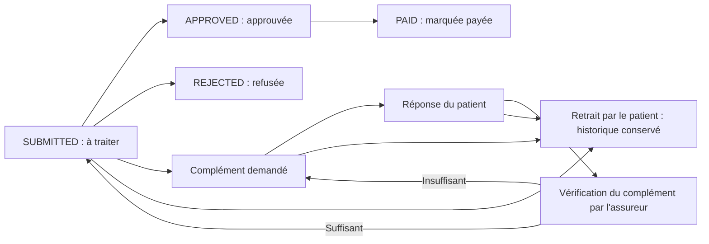

# Module Assurance — MediLink

Ce document présente le module Assurance, son fonctionnement et les parties du code à montrer lors d'une démonstration ou d'une soutenance.

Le module permet à un **patient** de déclarer un contrat d'assurance, estimer son reste à charge et déposer une demande de remboursement. Un **assureur** du même organisme peut consulter le dossier, demander un complément et enregistrer une décision. Le patient suit ensuite l'évolution de sa demande.

> **Portée actuelle :** il s'agit d'une démonstration locale. Les comptes utilisent la même base SQLite sur une même installation. Aucun organisme externe n'est contacté et aucun virement n'est effectué.

## 1. Présentation rapide

| Élément | Choix dans le projet |
| --- | --- |
| Interface | Flutter, Material 3 et thème MediLink |
| Langage | Dart |
| Données | Base SQLite déjà utilisée par l'application |
| Navigation | `go_router` |
| Accès aux services | `get_it` et `InsuranceRepository` |
| Lecture de facture | Tesseract, exécuté localement |
| Rôles | Patient et assureur |

**Question possible : « Avez-vous changé les tables ? »**  
Le module Assurance n'a ajouté ni modifié de table, de colonne ou d'index pour ces fonctionnalités. Depuis l'intégration de `main`, la base commune est en **version 6** pour les évolutions des autres modules. Les actions Assurance ajoutent et mettent à jour des **données** dans les tables existantes. La section [Base de données](#6-base-de-données-et-absence-de-migration) détaille ce choix.

## 2. Démontrer le parcours complet

Depuis la racine du projet :

```bash
flutter pub get
flutter run
```

Utiliser une seule installation de l'application pour les deux comptes :

| Rôle | Adresse e-mail | Mot de passe de démonstration |
| --- | --- | --- |
| Patient | `patient@medilink.tn` | `Medilink123` |
| Assureur CNAM | `assurance@medilink.tn` | `Medilink123` |

Ces comptes de démonstration sont créés lors de l'initialisation d'une nouvelle base. Ils sont définis dans [`database_seeder.dart`](../../core/database/database_seeder.dart).

1. Connectez-vous en tant que **patient** et ouvrez **Assurance** depuis le tableau de bord.
2. Dans **Mes contrats**, choisissez **Ajouter**. Saisissez l'organisme `CNAM`, un numéro de contrat et un taux, par exemple `70 %`.
3. Ouvrez **Simuler mon reste à charge** et saisissez `100 TND` : l'application estime `70 TND` remboursés et `30 TND` à la charge du patient.
4. Créez une demande avec le bouton **Nouvelle demande**. Saisissez le montant ; la date, le lien vers un soin et les images sont facultatifs. Une facture peut être choisie depuis la galerie ou le dossier médical.
5. Si une image de facture est jointe, choisissez **Lire la facture**. Vérifiez les valeurs proposées et cochez la confirmation avant d'enregistrer.
6. Déconnectez-vous, puis connectez-vous en tant qu'**assureur CNAM** sur la même installation. Le contrat et la demande apparaissent dans son tableau de bord.
7. Ouvrez le dossier. Vous pouvez demander une pièce, approuver la demande ou la refuser avec un motif. Si vous demandez une pièce, reconnectez-vous avec le patient, ouvrez le dossier et choisissez **Compléter mon dossier**. Revenez à l'assureur et choisissez **Valider le complément** après vérification, ou **Complément insuffisant** pour préciser les pièces encore attendues. Une réponse du patient ne débloque pas automatiquement l'approbation.
8. Une demande approuvée peut être **marquée comme payée**. Reconnectez-vous avec le patient pour consulter l'historique et les notifications.

**Pourquoi le tableau de bord assureur peut-il afficher zéro ?** Il n'affiche que les contrats et demandes enregistrés dans la même base locale dont le nom d'organisme correspond à celui de l'assureur. Le compte de démonstration est associé à `CNAM` ; un contrat déclaré `STAR` n'apparaîtra pas dans son espace. L'écriture est comparée sans tenir compte de la casse et des espaces en début ou en fin de nom.

## 3. Fonctions côté patient

| Fonction | Ce que fait l'utilisateur | Où se trouve le code ? |
| --- | --- | --- |
| Consulter son espace | Ouvre ses contrats et ses demandes. | [`InsuranceHomeScreen`](presentation/screens/insurance_home_screen.dart), `refresh()` et `build()` ; [`InsuranceRepository`](data/insurance_repository.dart), `patientContracts()` et `patientClaims()`. |
| Ajouter un contrat | Saisit l'organisme, le numéro, le taux estimé et éventuellement les dates de validité. Un doublon pour le même patient est refusé. Les noms reconnus reprennent l'écriture du catalogue partagé ; « Autre » seul doit être précisé. | `InsuranceContractForm.save()` dans [`insurance_contract_form.dart`](presentation/screens/insurance_contract_form.dart), `addContract()` dans [`insurance_repository.dart`](data/insurance_repository.dart). |
| Modifier ou supprimer un contrat | Boutons visibles sur les contrats sans aucune demande liée. Vérification du propriétaire et de l'absence d'historique dans une transaction. | `updateContract()`, `deleteContract()`, `_ownContract()` dans [`insurance_repository.dart`](data/insurance_repository.dart) ; `ContractCard` dans [`insurance_widgets.dart`](presentation/screens/insurance_widgets.dart). |
| Désactiver / réactiver un contrat | Empêche de nouvelles demandes sans interrompre le traitement des anciennes. Une réactivation reste soumise aux dates de validité et ne certifie pas le contrat. | `manageContract()` dans [`insurance_home_screen.dart`](presentation/screens/insurance_home_screen.dart), `setContractActive()` dans [`insurance_repository.dart`](data/insurance_repository.dart). |
| Simuler le reste à charge | Choisit un contrat actif et saisit les frais ; aucune demande n'est créée. | `InsuranceSimulator` dans [`insurance_forms.dart`](presentation/screens/insurance_forms.dart) ; `insuranceEstimate()` dans [`insurance_dossier.dart`](data/insurance_dossier.dart). |
| Déposer une demande | Choisit un contrat et un montant ; peut ajouter la date des soins, des images et un lien vers un soin. | `InsuranceClaimForm`, notamment `save()`, dans [`insurance_forms.dart`](presentation/screens/insurance_forms.dart) ; `submitClaim()` dans [`insurance_repository.dart`](data/insurance_repository.dart). |
| Joindre un justificatif | Sélectionne une photo ou une image du dossier médical. La copie ajoutée à la demande reste disponible même si le document source est supprimé du dossier médical. | `InsuranceEvidencePicker` dans [`insurance_forms.dart`](presentation/screens/insurance_forms.dart) ; `patientDocuments()` dans [`insurance_repository.dart`](data/insurance_repository.dart). |
| Lire une facture | Lance la reconnaissance de texte sur la **première image** ; le montant et la date détectés sont proposés pour vérification. | `scan()` dans [`insurance_forms.dart`](presentation/screens/insurance_forms.dart), `recognizeInvoice()` dans [`invoice_ocr.dart`](data/invoice_ocr.dart) et `InvoiceSuggestions.fromText()` dans [`insurance_dossier.dart`](data/insurance_dossier.dart). |
| Suivre et compléter le dossier | Consulte les pièces, l'historique et la prochaine étape ; ajoute une réponse et éventuellement des images tant que la demande est en attente. | [`InsuranceClaimScreen`](presentation/screens/insurance_claim_screen.dart), `_TimelineEvent` et `_DecisionForm` ; `claim()` et `complementClaim()` dans [`insurance_repository.dart`](data/insurance_repository.dart). |
| Corriger une demande | **Corriger les informations** permet de modifier le montant et la date avant décision, avec un motif obligatoire. Les anciennes valeurs restent dans l'historique. Pour changer le contrat ou le soin lié : retirer puis recréer. | `correctClaim()` et `_changePatientClaim()` dans [`insurance_repository.dart`](data/insurance_repository.dart) ; `_DecisionForm` dans [`insurance_claim_screen.dart`](presentation/screens/insurance_claim_screen.dart). |
| Retirer une demande | **Retirer ma demande** est disponible avant décision, avec confirmation et motif. Le dossier reste consultable ; aucune décision ni nouveau complément n'est ensuite autorisé. | `withdrawClaim()` et `_changePatientClaim()` dans [`insurance_repository.dart`](data/insurance_repository.dart). |
| Repérer les anomalies de parcours | Avertissement si aucun assureur actif ne correspond localement au contrat. Signalement de frais similaires : même patient, même montant et même date ou même soin lié. C'est une invitation à vérifier, pas une preuve de double remboursement. | `patientContracts()`, `_flagPossibleDuplicates()` dans [`insurance_repository.dart`](data/insurance_repository.dart) ; cartes dans [`insurance_widgets.dart`](presentation/screens/insurance_widgets.dart). |

### Calcul de l'estimation

```text
Remboursement estimé = montant des soins × taux de couverture déclaré
Reste à charge estimé = montant des soins − remboursement estimé
```

Les résultats sont arrondis à **trois décimales**, soit au millime tunisien. Exemple : pour `100 TND` et un taux de `70 %`, l'application affiche `70.000 TND` remboursés et `30.000 TND` à charge du patient.

Ce calcul est **indicatif** : le taux est déclaré par le patient et le simulateur n'applique pas les plafonds, franchises ou exclusions de l'organisme. Le montant finalement retenu peut être différent.

### Lecture locale de facture

1. L'utilisateur choisit une image de facture et lance la lecture.
2. Tesseract reconnaît le texte sur l'appareil ou dans le navigateur.
3. `InvoiceSuggestions.fromText()` recherche un montant associé à un libellé tel que « total TTC » et une date valide au format `jj/mm/aaaa` ou `jj-mm-aaaa`.
4. Les valeurs trouvées sont proposées dans le formulaire. L'utilisateur doit les vérifier avant l'enregistrement ; il peut aussi tout saisir manuellement.

La reconnaissance peut se tromper ou ne rien détecter : elle ne valide pas une facture et ne remplace pas la vérification humaine. Aucun document n'est envoyé à un service OCR externe. Formats acceptés : **JPEG, PNG et WebP** ; limite de **3 Mo par image**, **5 images** et **6 Mo au total** pour un dossier. Le module ne prend pas en charge les PDF comme justificatifs.

## 4. Fonctions côté assureur

| Fonction | Comportement | Où se trouve le code ? |
| --- | --- | --- |
| Tableau de bord | Présente les contrats, le nombre de demandes à traiter et le montant marqué comme payé. | [`InsurerDashboardScreen`](presentation/screens/insurer_dashboard_screen.dart), `_content()` ; `insurerContracts()` et `insurerClaims()` dans [`insurance_repository.dart`](data/insurance_repository.dart). |
| Recherche et filtres | Recherche par nom de patient, numéro de contrat ou numéro de dossier ; distingue les demandes à traiter, pièces attendues, compléments à vérifier, retraits et décisions. Le compteur « à traiter » exclut les retraits et l'attente du patient. | `_content()`, `matches()` et `ChoiceChip` dans [`insurer_dashboard_screen.dart`](presentation/screens/insurer_dashboard_screen.dart) ; `insuranceClaimState()` dans [`insurance_dossier.dart`](data/insurance_dossier.dart). |
| Consulter un dossier | Affiche les informations, images agrandissables, historique et prochaine étape. | [`insurance_claim_screen.dart`](presentation/screens/insurance_claim_screen.dart) et `claim()` dans [`insurance_repository.dart`](data/insurance_repository.dart). |
| Demander des pièces | Enregistre une consigne destinée au patient et crée une notification. Une seule demande de complément peut être en attente à la fois. | `_DecisionForm` dans [`insurance_claim_screen.dart`](presentation/screens/insurance_claim_screen.dart) ; `requestDocuments()` dans [`insurance_repository.dart`](data/insurance_repository.dart). |
| Vérifier un complément | Après une réponse du patient, accepte le complément avec une explication ou redemande les pièces manquantes. Cette étape ne décide pas du remboursement. | `reviewComplement()` dans [`insurance_repository.dart`](data/insurance_repository.dart) ; `_DecisionForm` dans [`insurance_claim_screen.dart`](presentation/screens/insurance_claim_screen.dart). |
| Approuver | Enregistre un montant compris entre zéro et les frais déclarés. Un montant différent de l'estimation nécessite un motif. L'approbation reste bloquée tant que le complément demandé n'est pas validé par l'assureur. | `changeClaimStatus(..., 'APPROVED')` dans [`insurance_repository.dart`](data/insurance_repository.dart). |
| Refuser | Enregistre un refus avec un motif obligatoire. | `changeClaimStatus(..., 'REJECTED')` dans [`insurance_repository.dart`](data/insurance_repository.dart). |
| Marquer comme payée | Après approbation, enregistre manuellement le statut et éventuellement une référence. | `changeClaimStatus(..., 'PAID')` dans [`insurance_repository.dart`](data/insurance_repository.dart). |

**Important :** « marquée comme payée » signifie que l'assureur a enregistré cette information dans l'application. MediLink ne réalise pas de paiement et ne vérifie pas qu'un virement a eu lieu.

## 5. Statuts et historique d'une demande



Une demande de complément est une **information supplémentaire du dossier** : elle ne crée pas un nouveau statut dans la table. La demande reste `SUBMITTED` et l'assureur doit vérifier la réponse avant de pouvoir l'approuver. Un refus reste possible avec un motif. Une correction ou un complément spontané est possible tant que le dossier n'a pas de décision et n'est pas retiré.

Le retrait utilise `withdrawn: true` dans le dossier JSON : la colonne SQL reste `SUBMITTED` pour respecter la contrainte existante. **Tout futur consommateur de ces données doit utiliser `insuranceClaimState()` ou appliquer la même règle**, sinon il compterait à tort les retraits parmi les demandes à traiter. `complementReceived` distingue une réponse reçue d'une réponse validée. Ces champs sont facultatifs pour relire les anciens dossiers.

L'historique mémorise les événements tels que le dépôt, la demande de pièces, la réponse, l'approbation, le refus et le paiement marqué. Chaque événement contient un auteur, une date et, selon l'action, un motif ou un montant. Il est construit par `InsuranceDossier.record()` dans [`insurance_dossier.dart`](data/insurance_dossier.dart) et affiché par `_TimelineEvent` dans [`insurance_claim_screen.dart`](presentation/screens/insurance_claim_screen.dart).

## 6. Base de données et absence de migration

Le module réutilise les tables déjà définies dans [`insurance_schema.dart`](../../core/database/schema/insurance_schema.dart) :

| Table existante | Rôle | Champs importants |
| --- | --- | --- |
| `insurance_contracts` | Contrats déclarés par les patients. | `patient_id`, `company`, `policy_number`, `coverage_rate`, dates et `status`. |
| `insurance_claims` | Demandes de remboursement rattachées à un contrat. | `contract_id`, liens facultatifs vers un soin, `amount`, `reimbursed_amount`, `status`, `document_path`, `submitted_at`. |
| `notifications` | Notifications internes aux comptes. | `user_id`, `type`, `title`, `body`, `payload`, état de lecture. Voir [`shared_schema.dart`](../../core/database/schema/shared_schema.dart). |

Les tables `consultations`, `prescriptions` et `medical_documents` existantes sont également consultées lorsque le patient décide de lier un soin ou d'ajouter un document médical.

### Comment stocker les nouvelles informations sans ajouter de colonne ?

La colonne texte existante `insurance_claims.document_path` contient un dossier au format JSON, précédé de `medilink-dossier:v1:`. Il regroupe :

- la date des soins, si elle est renseignée ;
- les images jointes, encodées en Base64 ;
- la consigne de pièces demandées, s'il y en a une ;
- les indicateurs de retrait et de réponse reçue ;
- l'historique des événements et leurs détails ;
- un ancien chemin éventuel, conservé pour les dossiers créés avant cette convention.

Le codage et le décodage sont dans `InsuranceDossier.encode()` et `InsuranceDossier.decode()` : [`insurance_dossier.dart`](data/insurance_dossier.dart). Les anciens chemins simples sont conservés. Pour afficher une ancienne pièce dont seul le chemin est connu, le patient doit en joindre une copie. Si un dossier au format actuel est illisible, le module renvoie une erreur au lieu de l'écraser silencieusement.

Une **transaction SQLite** enregistre ensemble une action et les notifications associées : elles sont validées ou annulées ensemble. La version commune est `6` dans [`app_database.dart`](../../core/database/app_database.dart), à la suite des changements intégrés depuis `main`. Le test `dossier lifecycle, evidence snapshot, notifications and unchanged schema` compare les définitions SQLite avant et après le parcours Assurance.

**Attention aux données existantes :** la procédure de mise à jour commune détruit et recrée actuellement les tables lors d'un changement de version. Une base locale antérieure, y compris ses contrats et demandes, sera donc effacée au premier lancement avec la version 6. Sauvegardez-la avant la mise à jour ; une migration conservant les données doit être définie avec l'équipe responsable de la base commune.

**MySQL est-il nécessaire ?** Non. Ce module utilise la base **SQLite locale** existante. Le fichier PostgreSQL des médicaments appartient au périmètre pharmacie et n'est pas nécessaire à ce parcours d'assurance.

## 7. Liens avec le reste de l'application

| Module ou service | Lien avec Assurance | Où voir le code ? |
| --- | --- | --- |
| Session et rôles | L'utilisateur connecté détermine s'il est patient ou assureur. Les routes et le repository limitent l'accès. | [`insurance_module.dart`](insurance_module.dart), `_patientId`, `_insurerCompany()` et `claim()` dans [`insurance_repository.dart`](data/insurance_repository.dart) ; [`session_service.dart`](../../core/session/session_service.dart). |
| Dossier médical | Le patient peut choisir une copie d'un de ses documents existants. | `patientDocuments()` dans [`insurance_repository.dart`](data/insurance_repository.dart) ; [`medical_record_repository.dart`](../user/data/repositories/medical_record_repository.dart). |
| Médecin | Une demande peut référencer une consultation ou une ordonnance du patient ; les identifiants sont vérifiés avant enregistrement. Les notes cliniques ne sont pas affichées à l'assureur. | `patientCareLinks()`, `_validateLink()` et `submitClaim()` dans [`insurance_repository.dart`](data/insurance_repository.dart) ; [`doctor_schema.dart`](../../core/database/schema/doctor_schema.dart). |
| Notifications | L'assureur est prévenu d'une nouvelle demande ou d'un complément ; le patient est prévenu d'une demande de pièces et des décisions. Les notifications ouvrent le dossier associé. | `_notify()` et `_notifyInsurers()` dans [`insurance_repository.dart`](data/insurance_repository.dart) ; [`notification_service.dart`](../../core/notifications/notification_service.dart) et [`notifications_screen.dart`](../shell/presentation/screens/notifications_screen.dart). |
| Navigation et thème | Le module enregistre ses routes, son repository et le raccourci patient ; les cartes et boutons reprennent le thème MediLink. | [`insurance_module.dart`](insurance_module.dart), [`insurance_widgets.dart`](presentation/screens/insurance_widgets.dart) et [`app_theme.dart`](../../core/theme/app_theme.dart). |

Le contrôle par organisme compare un **nom déclaré localement**, pas un contrat vérifié auprès de la CNAM ou d'une mutuelle. Il est adapté à cette démonstration, mais ne suffit pas pour un véritable service multi-utilisateur.

### Tâches à coordonner avec les autres membres lors de l'intégration

Les modules des autres membres ne sont pas encore tous intégrés à cette copie. Cette liste décrit les **interfaces attendues et les vérifications à faire ensemble**, sans demander de réécrire leur travail. Aucun fichier de ces modules ni aucune table n'est modifié dans cette étape Assurance.

| Responsable | Travail attendu dans son périmètre | Critère de validation commun avec Assurance |
| --- | --- | --- |
| Utilisateurs / administrateur — priorité avant usage réel | Faire valider l'affiliation d'un assureur et réserver son changement à une procédure autorisée. Le profil local peut actuellement modifier `insurers.company`, alors qu'Assurance utilise ce champ pour filtrer les dossiers. | Un assureur ne peut pas accéder aux dossiers d'un autre organisme en changeant librement son profil. Cette garantie nécessite une affiliation autoritative hors du module Assurance. |
| Utilisateurs / session | Appliquer les suspensions de compte aux sessions déjà ouvertes et vérifier l'identité côté service partagé. | Un compte désactivé perd l'accès sans devoir compter sur une déconnexion volontaire. Le contrôle local d'assureur actif existe déjà dans `_insurerCompany()` ; le contrat global de session reste à coordonner. |
| Utilisateurs / dossier médical | Choisir la source de vérité pour l'assurance principale, car les champs du dossier médical et `insurance_contracts` sont actuellement indépendants. Définir un identifiant de bénéficiaire si les ayants droit doivent être couverts. | Une correction n'affiche pas deux numéros contradictoires ; un remboursement désigne clairement le titulaire ou un bénéficiaire autorisé. Pour l'instant Assurance couvre le patient connecté uniquement. |
| Médecin | Exposer les consultations / ordonnances persistées avec le même `patient_id`, les identifiants stables et la date du soin. Fournir une référence de facture et les frais réellement facturés lorsqu'ils existent. Vérifier le raccordement des raccourcis au véritable dossier médical autorisé. | Un soin enregistré apparaît dans **Lien vers un soin** pour son patient uniquement. Une ordonnance ou un tarif de profil ne constitue pas une preuve de paiement. Les notes cliniques ne sont pas transmises à l'assureur. |
| Rendez-vous | Relier une consultation réalisée à son rendez-vous ; distinguer prévu, annulé et réalisé, ainsi que devis, acompte et facture. | Un rendez-vous annulé n'est pas présenté comme un soin effectué ou une dépense remboursable. L'intégration devra préciser quelles prestations sont finalisées. |
| Pharmacie | Fournir la vente / délivrance réellement effectuée : patient, ordonnance éventuelle, professionnel, quantités, montants et référence de reçu. Prévoir les livraisons partielles et retours. | Le justificatif correspond aux produits effectivement délivrés et au montant payé, pas simplement à une ordonnance ou à un panier. Les évolutions éventuelles du modèle pharmacie se décident avec son responsable. |
| Notifications / infrastructure | Conserver le lien `claimId` vers `/insurance/claim/:id`. Définir la livraison entre appareils lors du passage à un backend. | Une notification ouvre le bon dossier, dont l'accès reste vérifié. Les notifications locales existent déjà ; elles ne sont pas des notifications distantes. |
| Équipe backend / authentification | Définir les identifiants d'organisme, l'autorisation côté serveur, la synchronisation et le stockage sécurisé des pièces. | Patient et assureur voient les mêmes mises à jour sur deux appareils, sans dépendre d'une base locale commune. Aucun changement de schéma ni backend n'est livré par cette étape. |

### Qui doit avoir le CRUD ?

CRUD signifie **créer, lire, modifier, supprimer**. Il ne faut pas donner les quatre opérations à chaque rôle sans règle métier.

| Objet et rôle | Créer / lire | Modifier | Supprimer ou alternative |
| --- | --- | --- | --- |
| Contrat — patient propriétaire | Oui | Oui tant qu'aucune demande ne le référence : organisme, numéro, taux et dates. | Suppression avec confirmation uniquement sans demande. Sinon **Désactiver**, pour conserver l'historique. |
| Demande — patient propriétaire | Déposer et consulter | Montant et date avec motif avant décision ; pièces et réponse via complément. | **Retirer ma demande** avant décision, sans suppression physique. Aucun effacement d'un dossier approuvé, refusé ou payé. |
| Dossier — assureur du même organisme | Consulter les dossiers reçus | Demander / vérifier les pièces, approuver ou refuser, puis marquer payé après approbation. | Pas de suppression des déclarations du patient ni des décisions enregistrées. |
| Contrat — assureur | Consulter ceux déclarés pour son organisme | Pas d'édition des déclarations du patient ; l'assureur fixe le montant retenu dans sa décision motivée. | Pas de suppression du contrat du patient. |
| Médecin, pharmacien, administrateur | Aucun nouvel accès Assurance accordé par cette livraison. | Les intégrations futures doivent définir un besoin et des droits explicites. | Aucun CRUD Assurance ajouté dans leurs espaces. |

**Pourquoi ne pas supprimer un contrat déjà utilisé ?** La relation SQL existante supprime les demandes en cascade. `deleteContract()` vérifie donc l'absence de demandes dans la même transaction avant toute suppression. Même une demande retirée conserve son historique et protège son contrat. Pour de nouvelles conditions après utilisation : désactiver l'ancien contrat puis créer une nouvelle référence de contrat ; ne pas réécrire les conditions des anciens dossiers.

## 8. Structure des fichiers

```text
lib/features/insurance/
├── README.md                          Ce document
├── insurance_module.dart             Routes, dépendance et raccourci
├── data/
│   ├── insurance_repository.dart     Accès aux données et règles métier
│   ├── insurance_dossier.dart        Dossier, pièces, calcul et extraction des valeurs
│   ├── invoice_ocr.dart              Point d'entrée OCR selon la plateforme
│   ├── invoice_ocr_native.dart       OCR Android / iOS
│   ├── invoice_ocr_web.dart          OCR navigateur
│   └── invoice_ocr_stub.dart         Plateforme non prise en charge
└── presentation/screens/
    ├── insurance_home_screen.dart    Espace patient et ajout de contrat
    ├── insurance_contract_form.dart  Création / modification et dates de validité
    ├── insurer_dashboard_screen.dart Espace assureur et filtres
    ├── insurance_forms.dart          Simulateur, pièces et dépôt de demande
    ├── insurance_claim_screen.dart   Détail, historique et actions sur un dossier
    └── insurance_widgets.dart        Cartes, états vides et animation des boutons
```

Autres emplacements utiles : [`pubspec.yaml`](../../../pubspec.yaml) pour les dépendances, [`assets/tessdata/`](../../../assets/tessdata/) pour les modèles de langue, [`web/insurance_ocr.js`](../../../web/insurance_ocr.js) et [`web/ocr/`](../../../web/ocr/) pour l'OCR Web. Les licences des composants OCR sont conservées avec ces fichiers.

## 9. Tester le module

Depuis la racine du projet :

```bash
flutter analyze
flutter test test/features/insurance
flutter test
flutter build web
```

| Test | Ce qu'il vérifie |
| --- | --- |
| [`insurance_dossier_test.dart`](../../../test/features/insurance/insurance_dossier_test.dart) | Calcul au millime, dates et extraction prudente des valeurs d'une facture. |
| [`insurance_repository_test.dart`](../../../test/features/insurance/insurance_repository_test.dart) | Parcours de remboursement, droits d'accès, justificatifs, historique, notifications, ancien chemin et structure inchangée de la base. |
| [`insurance_screen_test.dart`](../../../test/features/insurance/insurance_screen_test.dart) | Formulaires, simulateur, parcours patient–assureur, filtres, notifications et différentes largeurs d'écran. |
| [`insurance_crud_screen_test.dart`](../../../test/features/insurance/insurance_crud_screen_test.dart) | Boutons modifier / supprimer / désactiver, correction et retrait d'une demande, à 320 px avec le thème réel de l'application. |

Le test navigateur facultatif [`verify_insurance_ocr.cjs`](../../../tool/verify_insurance_ocr.cjs) utilise une facture synthétique : il vérifie la reconnaissance et l'absence de requête OCR externe. Il nécessite Chrome et `playwright-core` installés séparément ; la variable `PLAYWRIGHT_CORE_PATH` peut pointer vers le dossier du paquet.

## 10. Limites et évolutions possibles

- Les données sont locales à une installation et ne sont pas synchronisées entre les appareils. Patient et assureur doivent utiliser la même installation pour la démonstration.
- Le contrat et son taux sont déclarés par le patient. Il n'y a pas de vérification auprès de l'organisme, de gestion des accords préalables officiels ni de connexion à un portail CNAM ou à une mutuelle.
- Le module n'effectue pas de virement réel. La validation du paiement est manuelle.
- Les corrections et retraits sont disponibles avant décision. Les brouillons, recours après refus et renouvellements conservant le même numéro ne sont pas implémentés ; ils nécessitent des règles métier distinctes. Un refus n'est pas réouvert silencieusement.
- Les pièces déjà transmises ne sont pas supprimables ni remplaçables ; un complément peut ajouter une copie dans les limites de stockage. Un véritable remplacement versionné des justificatifs reste à concevoir pour éviter d'effacer les pièces utilisées dans une décision, notamment lorsque la limite est atteinte.
- Le signalement de frais similaires est une heuristique locale, sans référence de facture normalisée. L'assureur ne compare que les dossiers de son organisme ; le patient voit ses propres dossiers. Les cas légitimes de couverture complémentaire ne sont pas bloqués automatiquement.
- Les données et les images sont stockées localement dans SQLite ; le Base64 est un encodage, **pas un chiffrement**. Une version de production nécessiterait notamment un backend sécurisé, une politique de stockage adaptée et une vraie gestion des accès et des droits.
- L'OCR Web a été essayé sur une facture synthétique. L'intégration native Android/iOS doit encore être validée sur un appareil ou un émulateur avant livraison.

Pour une version réelle, la prochaine étape serait donc de définir une API et un stockage sécurisés avec les autres membres de l'équipe, puis d'intégrer les règles de chaque organisme sans présenter les estimations locales comme des décisions officielles.

### Préparer le futur système de recommandation

Le système de recommandation n'est **pas implémenté** dans cette étape. Avant de le développer, choisir précisément ce qu'il recommande : par exemple des offres d'assurance adaptées à un budget et à des besoins déclarés. Il faudra un catalogue d'offres avec garanties, plafonds, exclusions et critères d'éligibilité ; les taux saisis par les patients ne suffisent pas à représenter les offres réelles.

Un premier prototype pourra rester entièrement dans Assurance, avec un catalogue de démonstration explicite, des préférences saisies volontairement et un classement expliqué. Définir ensuite les critères d'évaluation et déterminer si un modèle apporte un bénéfice par rapport à des règles. Aucune recommandation ne doit valider automatiquement un remboursement ou exploiter les notes médicales d'autres espaces sans contrat d'accès approprié.
